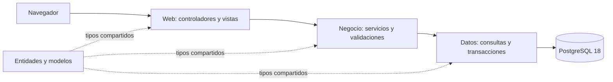

# Diseño del sistema según los requisitos originales

Estado: diseño aprobado, esquema de la etapa 2 validado en PostgreSQL 18.6 de
Windows. La etapa 3 incorpora la migración 004 y la seguridad de aplicación;
su validación final en Windows queda pendiente.
Los módulos comerciales se desarrollarán en las etapas siguientes. El alcance íntegro está en
[requisitos-originales.md](requisitos-originales.md).

## Etapas y situación actual

La numeración original del prompt pasa a ser la referencia:

| Etapa original | Situación |
| --- | --- |
| 1. Arquitectura, solución y PostgreSQL | Base existente validada: cuatro proyectos net48, pantalla MVC 5 y conexión con PostgreSQL 18.6. |
| 2. Tablas, relaciones y datos iniciales | Validada por el usuario en PostgreSQL 18.6 de Windows. |
| 3. Inicio de sesión, usuarios, roles y permisos | Implementada localmente; pruebas de servicios/filtros y Razor realizadas; pendiente Windows/IIS. |
| 4. Productos, categorías, marcas, clientes y proveedores | Pendiente. |
| 5. POS | Pendiente. |
| 6. Compras y stock | Pendiente. |
| 7. Caja | Pendiente. |
| 8. Dashboard y reportes | Pendiente. |
| 9. Pruebas y optimización | Pendiente; además habrá validación al finalizar cada etapa. |

Los documentos anteriores `etapa-1-mvc.md` y `etapa-2-postgresql.md` describen
los pasos de preparación ya realizados, ambos comprendidos en la etapa 1 del
prompt original. Se conservan para no perder las instrucciones probadas.

## Arquitectura y acceso a datos

Se conservan los proyectos existentes, .NET Framework 4.8, MVC 5, Bootstrap 5,
JavaScript y PostgreSQL 18. Se elige **ADO.NET con Npgsql**: ya se utiliza para
la conexión y permite expresar las transacciones y actualizaciones de stock
de forma directa. No se añade Entity Framework 6 ni se migra a ASP.NET Core.



Las referencias actuales son correctas: Web → Negocio/Entidades, Negocio →
Datos/Entidades y Datos → Entidades. Los controladores no contienen SQL.
Las reglas se validan en Negocio; las restricciones críticas también se
comprueban dentro de la transacción y en PostgreSQL para evitar carreras.

Los repositorios de una operación comparten una conexión y una transacción.
La unidad de trabajo residirá en Datos; Negocio podrá usar sus operaciones sin
depender directamente de tipos Npgsql. Cada consulta recibe parámetros.

Estructura prevista, a crear progresivamente al implementar cada módulo:

```text
SistemaVentas.Web/
  Controllers/             Acceso, Usuarios, Productos, Ventas, Compras, Caja…
  ViewModels/              Datos y validación de formularios
  Filters/                 Autorización por permiso
  Views/Shared/            Diseño general con menú lateral
  Views/                   Vistas de cada módulo y pantalla POS propia
  Scripts/aplicacion/      Interacción y búsquedas; reglas finales en servidor
SistemaVentas.Entidades/   Entidades, solicitudes y resultados compartidos
SistemaVentas.Negocio/     Servicios de cada módulo y reglas de negocio
SistemaVentas.Datos/      Repositorios, conexión y unidad de trabajo
database/                 Scripts SQL versionados y comprobaciones
docs/                     Requisitos, diseño, instalación y pruebas
tools/                    Configuración y administración local
```

## Diseño inicial de PostgreSQL

Esquema `public`, nombres en minúsculas y claves `BIGINT GENERATED BY DEFAULT
AS IDENTITY`. Las tablas puente usan claves primarias compuestas.
Los campos de una fila se refieren a la misma base; las relaciones usan claves
foráneas y se restringe borrar registros referenciados por operaciones.

### Seguridad

| Tabla | Campos principales y relaciones |
| --- | --- |
| `usuarios` | id, nombre_usuario, nombre, correo, password_hash, activo, ultimo_acceso, creado_en. Nombre de usuario único sin distinguir mayúsculas. |
| `roles` | id, codigo único, nombre, activo. Iniciales: ADMINISTRADOR, SUPERVISOR y CAJERO. |
| `permisos` | id, codigo único, modulo, descripcion. Ejemplos: PRODUCTOS_VER, PRODUCTOS_EDITAR, VENTAS_CONFIRMAR, CAJA_CERRAR. |
| `usuarios_roles` | usuario_id → usuarios, rol_id → roles; clave compuesta sin duplicados. |
| `roles_permisos` | rol_id → roles, permiso_id → permisos; clave compuesta. Completa la relación requerida para autorizar módulos. |

El usuario de PostgreSQL `sistemaventas_app` es la cuenta de conexión técnica.
Los usuarios Administrador/Supervisor/Cajero serán filas de `usuarios`, no nuevos
roles de PostgreSQL ni credenciales compartidas de la base de datos.

Permisos iniciales propuestos; la autorización se resuelve por permiso asignado,
no por comparar literalmente el nombre del rol en cada controlador:

| Operación | Administrador | Supervisor | Cajero |
| --- | --- | --- | --- |
| Usuarios, roles y permisos | Sí | No | No |
| Productos, categorías, marcas y proveedores | Sí | Sí | Consulta de productos para vender |
| Clientes | Sí | Sí | Consulta y registro para ventas |
| Confirmar ventas | Sí | Sí | Sí |
| Compras y ajustes de stock | Sí | Sí | No |
| Apertura/cierre de caja | Sí | Sí | Su propia sesión |
| Historial de cajas, dashboard y reportes globales | Sí | Sí | Solo comprobantes de sus operaciones |

La regla de propiedad de la sesión se verifica además del permiso de caja.

### Catálogos y personas

| Tabla | Campos principales y relaciones |
| --- | --- |
| `categorias` | id, nombre único normalizado, activo. |
| `marcas` | id, nombre único normalizado, activo. |
| `unidades_medida` | id, codigo único, nombre. Iniciales: unidad, kilogramo y litro. |
| `clientes` | id, nombre, tipo_documento, documento, telefono, direccion, correo, es_generico, activo. Índice único parcial para documentos informados. Un solo cliente genérico. |
| `proveedores` | id, nombre, ruc, telefono, direccion, correo, activo. RUC único cuando esté informado. |
| `metodos_pago` | id, codigo único, nombre, afecta_efectivo, activo. Iniciales: EFECTIVO, TARJETA, TRANSFERENCIA y OTROS. |
| `configuracion_comercio` | Una fila con nombre del comercio, moneda y zona_horaria. Valores iniciales PYG y America/Asuncion. |

### Productos e inventario

| Tabla | Campos principales y relaciones |
| --- | --- |
| `productos` | id, codigo único, descripcion, categoria_id, marca_id opcional, unidad_medida_id, permite_decimales, precio_compra, precio_venta, stock_actual, stock_minimo, activo. |
| `productos_codigos_barras` | id, producto_id → productos, codigo de barras único como texto. Una sola barra por producto; la migración 008 aplica esa unicidad y se conservan los ceros iniciales. |
| `movimientos_stock` | id, producto_id, usuario_id responsable, fecha, tipo, cantidad positiva, saldo_anterior, saldo_posterior, costo_unitario, observacion y referencia opcional al detalle de venta o compra. |

`permite_decimales` pertenece al producto, de modo que incluso una unidad pueda
fraccionarse cuando corresponda. Las unidades enteras se validan también en
servidor. Se admiten tres decimales: 0,250; 1,500; 2,750.

Tipos iniciales de movimiento: SALDO_INICIAL, ENTRADA_COMPRA, SALIDA_VENTA,
AJUSTE_ENTRADA y AJUSTE_SALIDA. El tipo determina el signo del cambio; la cantidad
guardada es positiva. Se verifica la igualdad entre saldo anterior, movimiento y
saldo posterior. Un detalle confirmado origina un solo movimiento, con índice
único sobre la referencia correspondiente. Ajustes requieren una observación.

El stock cambia únicamente junto con su movimiento y su auditoría, en la misma
transacción. No se modifica el stock mediante el formulario general de producto.
La existencia inicial se registra como SALDO_INICIAL. El historial es inmutable:
las correcciones posteriores se representan con movimientos compensatorios.

### Operaciones comerciales

| Tabla | Campos principales y relaciones |
| --- | --- |
| `ventas` | id, numero correlativo único, clave_idempotencia UUID única, fecha, cliente_id, usuario_id, caja_sesion_id, subtotal, descuento, total, estado. |
| `ventas_detalles` | id, venta_id, producto_id, cantidad, precio_unitario, descuento, subtotal y costo_unitario histórico. Copia de código, descripción y unidad vendidos para preservar el ticket. |
| `pagos` | id, venta_id, metodo_pago_id, monto aplicado, importe_recibido/vuelto para efectivo y referencia opcional. |
| `compras` | id, proveedor_id, usuario_id, fecha, numero_documento opcional, clave_idempotencia UUID única, total, estado. |
| `compras_detalles` | id, compra_id, producto_id, cantidad, costo_unitario y subtotal. |

Cabeceras y detalles se unen por claves foráneas; productos, usuarios, clientes
y proveedores referenciados se desactivan sin eliminar su historial.
Los estados de confirmación no se cambian con un UPDATE genérico: requieren el
servicio transaccional correspondiente. Una venta confirmada no se borra ni edita.

Los descuentos iniciales serán importes por línea. El descuento de cabecera es
la suma de los descuentos de sus líneas. Subtotal de línea = importe bruto
redondeado menos descuento, sin permitir descuentos negativos o superiores al
importe bruto. El servidor recalcula totales; no acepta los enviados por JavaScript
como resultado definitivo.

El pago aplicado debe coincidir con el total: no se habilitan pagos parciales.
En efectivo se distingue lo entregado por el cliente del monto aplicado y el
vuelto. Por ejemplo: total 10.000, recibido 20.000, vuelto 10.000, ingreso real
a caja 10.000. En los otros métodos no se genera vuelto.
Si un descuento permitido deja el total en cero, la venta mantiene su detalle y
su salida de stock, pero no crea pagos ni ingresos ficticios de importe cero.

El costo se conservará en cada detalle para los reportes históricos de ganancia
estimada. La valoración inicial será costo promedio ponderado: las compras
confirmadas actualizan precio_compra en la misma transacción que su entrada.
El precio de venta se mantiene como decisión comercial independiente.

### Caja, auditoría y versiones

| Tabla | Campos principales y relaciones |
| --- | --- |
| `cajas` | id, codigo único, nombre, activo. Representa el puesto físico. |
| `cajas_sesiones` | id, caja_id, usuario_apertura_id, fecha_apertura, monto_inicial, usuario_cierre_id, fecha_cierre, efectivo_esperado, efectivo_contado y diferencia. |
| `cajas_movimientos` | id, caja_sesion_id, usuario_id, fecha, tipo INGRESO/EGRESO, importe positivo, concepto y referencia opcional única a un pago. |
| `auditoria` | id, usuario_id opcional, fecha, accion, entidad, entidad_id y detalle JSONB depurado. |
| `esquema_versiones` | version única, nombre, checksum y fecha de aplicación de cada script. |

`cajas_sesiones` separa el puesto físico de cada apertura/cierre. Un índice único
parcial impide dos sesiones abiertas en una misma caja. Una venta debe pertenecer
a una sesión abierta. La confirmación bloquea esa sesión hasta terminar, igual
que el cierre, para que ambas operaciones no puedan cruzarse.

Efectivo esperado = monto inicial + ingresos en efectivo − egresos en efectivo.
Los pagos con tarjeta/transferencia se reportan desde pagos y no aumentan el
efectivo esperado. Una venta en efectivo genera un único ingreso por el monto
aplicado: no se suman otra vez sus totales al calcular el cierre. OTROS inicia
sin afectar efectivo; cualquier cambio de ese catálogo debe ser explícito.

El cierre solo se admite para una sesión abierta y calcula la diferencia como
efectivo contado − esperado. La diferencia puede ser negativa. Las compras no
suponen automáticamente un pago en efectivo: si se paga desde caja, se registra
su egreso una sola vez. Los datos de auditoría excluyen contraseñas, hashes,
cadenas de conexión y datos completos de tarjetas.

## Tipos, restricciones e índices

- Cantidades y stock: `NUMERIC(18,3)` ↔ `decimal` en C#; nunca float/double.
- Precios de compra y costo unitario: `NUMERIC(18,4)`; importes cobrados y totales:
  `NUMERIC(18,2)`. En esta versión se redondean importes a dos decimales, con la
  misma regla en C# (`MidpointRounding.AwayFromZero`) y PostgreSQL (`round`).
- Cantidades de detalles > 0; stock, stock mínimo y precios >= 0; descuentos
  dentro del importe bruto. Los montos nulos no equivalen a cero.
- Fechas de operaciones: `TIMESTAMPTZ DEFAULT CURRENT_TIMESTAMP`. Se guardan
  instantes y se presentan/agrupan usando `America/Asuncion`.
- En Windows/.NET Framework se mapeará esa zona a `Paraguay Standard Time`, con
  las reglas actualizadas del sistema. No se fija un offset UTC manual. Los
  filtros de día se convierten a límites de instantes, incluyendo inicio y
  excluyendo el comienzo del día siguiente.
- Índices sobre cada FK que interviene en búsquedas, fechas de ventas/compras,
  cliente+fecha, proveedor+fecha, usuario+fecha, producto+fecha en movimientos
  y caja_sesion+fecha. Códigos y códigos de barras llevan índices únicos.
- La búsqueda por descripción usará `pg_trgm` con un índice GIN y consultas
  parametrizadas; el índice por código de barras atenderá coincidencia exacta.
  Se verificará la disponibilidad de la extensión al aplicar los scripts.
- Un lector de códigos actuará como entrada de teclado en el POS. Su lectura
  no requiere un servicio externo ni confirma una venta por sí sola.
- El correlativo de venta se obtiene de una secuencia, nunca de MAX(numero)+1.
  La secuencia garantiza unicidad, pero puede dejar huecos ante una reversión.

## Confirmación de venta y concurrencia

Dentro de una única transacción:

1. Verificar usuario autorizado, cliente válido y sesión de caja abierta;
   bloquear la sesión de caja para coordinar su eventual cierre.
2. Consultar la clave de idempotencia de la solicitud. Repetir la misma
   solicitud devuelve la venta ya registrada; reutilizarla con otro contenido
   se rechaza. La restricción única resuelve solicitudes simultáneas.
3. Leer/bloquear productos en orden estable de id, validar actividad y cantidades,
   obtener los precios autorizados y recalcular descuentos, totales y pagos.
4. Descontar stock con una actualización condicionada a stock suficiente y
   comprobar sus filas afectadas. Si falta cualquier producto, revertir todo.
5. Registrar cabecera y detalles con sus valores históricos, movimientos de
   stock, pagos, movimientos de efectivo y auditoría usando la misma transacción.
6. Confirmar y devolver número/ticket solo después de completar la transacción.

La compra confirmada sigue el mismo principio para detalles, entrada de stock,
actualización de costo y auditoría. Los ajustes también son transaccionales.
Deshabilitar el botón del POS es una ayuda visual: la protección contra doble
registro reside en la base y el servidor.

## Seguridad e interfaz previstas

- Hash de contraseña PBKDF2-HMAC-SHA256 con sal aleatoria por usuario, al menos
  600.000 iteraciones y formato versionado para permitir actualizar parámetros.
  No se guardan contraseñas en claro ni hashes rápidos como SHA256 simple.
- Cookies de autenticación protegidas, HttpOnly, SameSite y HTTPS; gestión de
  sesión al entrar/salir. Se registra el último acceso al autenticar correctamente.
- Autorización por permiso en servidor y usuario activo; ocultar un menú no
  concede ni revoca permisos. El registro de cuentas será administrado, no público.
- Tokens CSRF en acciones de modificación, modelos de entrada específicos,
  validaciones en servidor y consultas parametrizadas. Los mensajes al usuario
  no incluyen detalles de conexión ni SQL.
- Layout con menú lateral, Bootstrap 5 y formularios/tablas adaptables; POS con
  diseño propio, foco para lector/teclado y pocas acciones para confirmar.
- Tablas con búsqueda, filtros y paginación desde el servidor. Dashboard y
  reportes consultarán datos reales de las operaciones confirmadas.
- Excel y PDF se incorporarán en la etapa 8 seleccionando bibliotecas compatibles
  con net48 y licencia apropiada. No son dependencias necesarias para crear el esquema.

## Scripts y datos iniciales de la etapa 2

```text
database/001_estructura.sql           Tablas, secuencias, FK, restricciones e índices
database/002_datos_iniciales.sql      Roles, permisos, unidades, pagos, cliente genérico y caja
database/003_comprobar_estructura.sql Consultas de integridad y datos iniciales
database/demo/001_productos.sql      Datos opcionales de prueba, sin ventas ni credenciales
```

Los scripts se aplicarán por versión, dentro de transacciones cuando corresponda,
sin DROP/RESET del trabajo existente. Se comprobará que repetir su aplicación no
duplique catálogos ni sobrescriba datos modificados. Un checksum distinto de una
versión aplicada exige una nueva migración en lugar de ocultar la diferencia.

El usuario administrador de la aplicación se creará de forma segura en la etapa 3,
solicitando una contraseña local y generando el hash. No habrá una contraseña
predeterminada compartida en SQL, documentación o GitHub.

Los campos `ventas.solicitud_hash` y `compras.solicitud_hash` conservan la firma
del contenido de la solicitud junto a su UUID de idempotencia. `pagos.es_efectivo`
conserva una copia del comportamiento del método para mantener el historial si
se modifica el catálogo. Los historiales son inmutables y los documentos se
confirman solo después de registrar todos sus efectos en la misma transacción.

Las comprobaciones diferidas validan al COMMIT tanto el documento completo como
la coincidencia entre stock y movimientos. La lógica de permisos, cálculo de
precios y respuesta a reintentos se implementará en los servicios de sus módulos.
Las instrucciones y límites de los scripts están en [database/README.md](../database/README.md).

Las restricciones SQL se probarán con datos válidos e inválidos dentro de
transacciones que después se reviertan. Se verificarán FK, unicidad, cantidades,
stock no negativo, roles/permisos y una sola sesión de caja abierta. Las pruebas
transaccionales completas de ventas/compras se realizarán al implementar esos
servicios en sus etapas correspondientes.

## Dependencias actuales y siguientes entregas

Se mantienen MVC 5.3.0, Razor/Web Pages 3.3.0, Bootstrap 5.2.3 y Npgsql 4.1.14
con las dependencias fijadas y probadas en la preparación. Npgsql 4.1 es una rama
antigua; el ensamblado net461 y su conexión con PostgreSQL 18.6 se comprobaron,
pero ello no equivale a soporte vigente del proveedor. Las dependencias se
revisarán al preparar una puesta en producción sin cambiar net48 unilateralmente.

Para la etapa de esquema solo se necesita PostgreSQL 18 y pgAdmin/psql. Antes de
ejecutar scripts se revisarán los objetos que ya existan en la base del usuario.
Cada etapa terminará con compilación, conexión, pruebas funcionales relevantes,
documentación y confirmación del usuario antes de avanzar.

El alcance completo de caja corresponde a la etapa 7. Para que el POS de la etapa
5 pueda cumplir su asociación obligatoria a una caja abierta, se implementará allí
el mínimo de apertura y registro necesario; el cierre, diferencias e historial se
completarán en la etapa 7. Esta dependencia se hace explícita para no simular una
caja ni guardar ventas desligadas de ella.

## Etapa 4.1: categorías y marcas

La administración de estos catálogos reutiliza las cuatro capas y permisos
existentes. La migración 006 impide asociar productos activos a categorías o
marcas inactivas mediante FK compuestas y una columna generada; conserva las FK
originales y los productos inactivos. La edición comprueba `xmin` para detectar
formularios obsoletos. No hay borrado físico ni cambios de stock en esta entrega.
El recorrido de archivos, migración y validación está en
[la guía de la etapa 4.1](etapa-4-1-catalogos.md).

## Etapa 4.2: productos

El módulo usa las tablas, índices y permisos existentes, sin una nueva migración
ni paquetes adicionales. Se distinguen `PRODUCTOS_VER`, `PRODUCTOS_EDITAR` y
`STOCK_VER`. Código, descripción, categoría, marca opcional, unidad, precios,
stock mínimo, IVA incluido y una barra por producto se administran desde MVC. La existencia se
consulta y no forma parte del contrato de escritura.

Las cantidades y precios se validan como `decimal`, respetando las escalas
numéricas del esquema. Las escrituras bloquean los catálogos antes del producto,
comprueban `xmin`, guardan la barra única y auditan en la misma transacción.
Un bloqueo transaccional serializa las escrituras del módulo para comprobar
conflictos entre códigos internos y barras de distintos productos. Los índices
únicos de PostgreSQL siguen protegiendo cada tipo de identificador por separado.

La unidad y el indicador de cantidades decimales se conservan cuando hay
existencias o historial, incluso después de volver a saldo cero. Los movimientos
se consultan con paginación y sin operaciones de edición. El recorrido de
archivos, reglas y revisión en Windows está en
[la guía de productos](etapa-4-2-productos.md).

### Corrección de productos: IVA y EAN-13

El usuario confirmó un código de barras por producto y precios con IVA incluido
(Exento, 5 %, 10 %). La migración 008 conserva el IVA anterior como pendiente
en lugar de asignar una tasa sin información. Una restricción única limita la
tabla existente de barras a una fila por producto. Una FK diferida vincula la
barra automática con la columna generada basada en su ID real.

Nuevo producto es un POST con antifalsificación: reserva un ID de la secuencia
y protege la reserva con MachineKey y el usuario actual. No inserta borradores
ni usa MAX(id)+1; admite saltos al cancelar. Ean13.cs usa 28 + ID de 10 dígitos
y control EAN-13. El servidor recalcula al guardar. Las futuras ventas/compras
conservarán la tasa y su liquidación en cada detalle; editar la tasa del
producto no debe recalcular documentos anteriores.

### Balanza: banderas, PLU y campo variable

La ampliación 010 conserva una sola barra por producto y agrega dos modos
excluyentes (pesable 20 y unitario 21), también excluyentes con EAN-13 interno
28. La identificación fija es bandera 2 + ID/PLU de 5 dígitos. Una etiqueta
completa es bandera 2 + PLU 5 + peso/cantidad codificado 5 + control EAN-13 1.
El campo variable no se guarda como parte del identificador del producto.

`CodigoBalanza.cs` separa los campos y valida el control antes de usar la
identificación fija para buscar. El lector conserva los cinco dígitos originales y, según la configuración
confirmada por el usuario, interpreta bandera 20 como gramos/1000 en kg y
bandera 21 como unidades enteras. La cantidad usa decimal y se expone junto
con su unidad de lectura. En el POS se validarán las cantidades y su coherencia
con el producto antes de registrar la venta.
Las casillas no cambian unidad, decimales ni stock. La relación diferida de
010 impide guardar una barra generada que no corresponda a su ID y tipo.

## Etapa 4.3: clientes

Se utilizan las tablas e índices existentes, sin nuevas migraciones ni paquetes.
`CLIENTES_REGISTRAR` y `CLIENTES_EDITAR` se validan por separado, con
`CLIENTES_VER` para acceder al módulo. El cajero puede registrar activos, pero
no modificar clientes existentes. El cliente genérico se consulta y conserva
sin cambios desde la aplicación; no se recibe `es_generico` al guardar.

Tipo y número de documento son opcionales como par; el índice existente evita
duplicados incluso entre inactivos. La edición usa bloqueo de fila y `xmin`,
y audita en la misma transacción. La desactivación conserva contactos y ventas.

El historial consulta solo ventas confirmadas. `VENTAS_VER_PROPIAS` limita
tanto documentos como contadores e importes al actor actual;
`VENTAS_VER_TODAS` permite la consulta completa. Las filas y totales se leen
en una misma instantánea. Archivos y revisión en Windows se explican en
[la guía de clientes](etapa-4-3-clientes.md).

## Etapa 4.4: proveedores

El módulo usa las tablas e índices existentes, sin una nueva migración ni
paquetes adicionales. `PROVEEDORES_ADMINISTRAR` protege consultas y escrituras;
el historial exige también `COMPRAS_ADMINISTRAR`. Administrador y Supervisor
poseen ambos permisos iniciales; Cajero no tiene acceso con su rol inicial.

Nombre o razón social es obligatorio; RUC y contacto son opcionales. El RUC
se conserva como texto y el índice existente impide duplicarlo incluso entre
inactivos. Editar y desactivar usan bloqueo de fila y comparación de `xmin`,
con auditoría en la misma transacción. Los registros se reactivan y no se
eliminan físicamente desde la aplicación.

El historial muestra compras confirmadas del proveedor con contador e importe
acumulado desde la misma instantánea que las filas paginadas. No crea compras
ni modifica inventario al consultar o actualizar los datos de contacto.
El recorrido de archivos y validación se explica en
[la guía de proveedores](etapa-4-4-proveedores.md).
